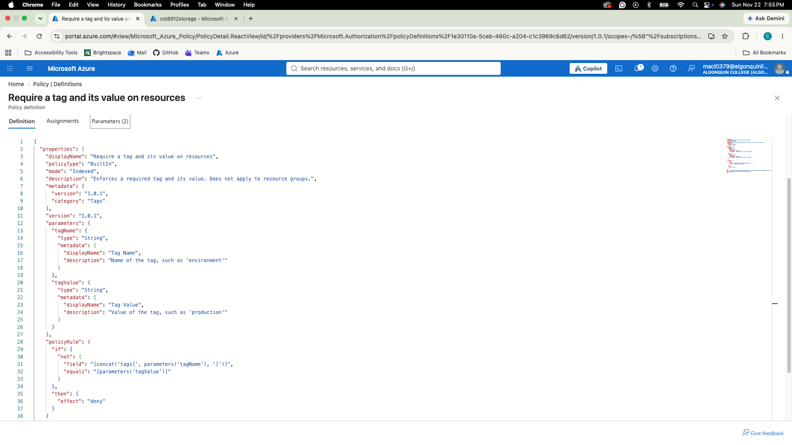
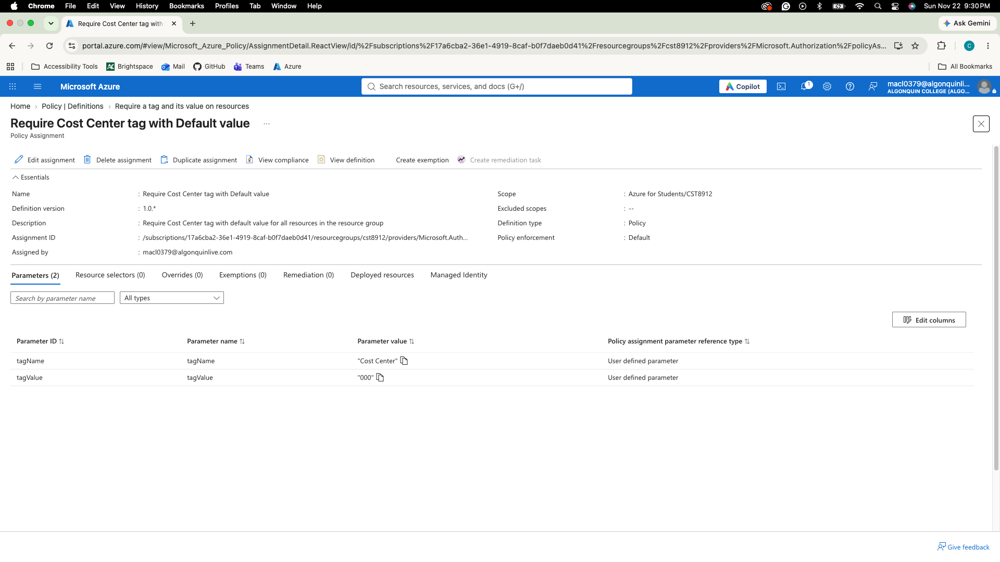
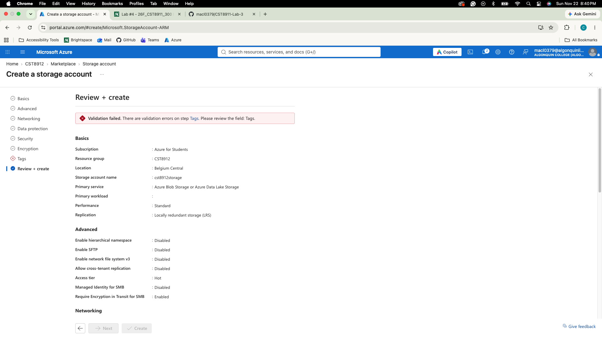
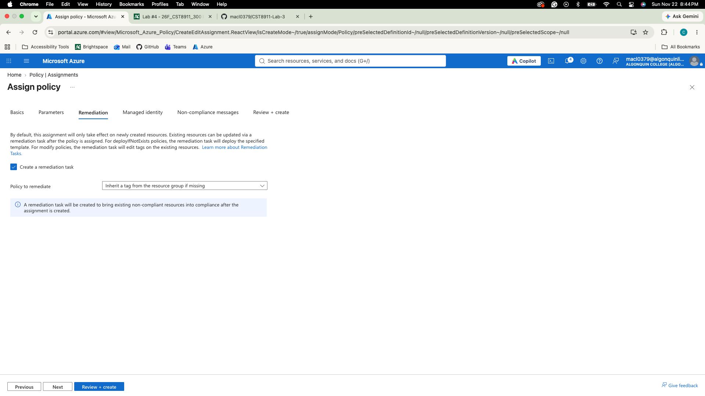
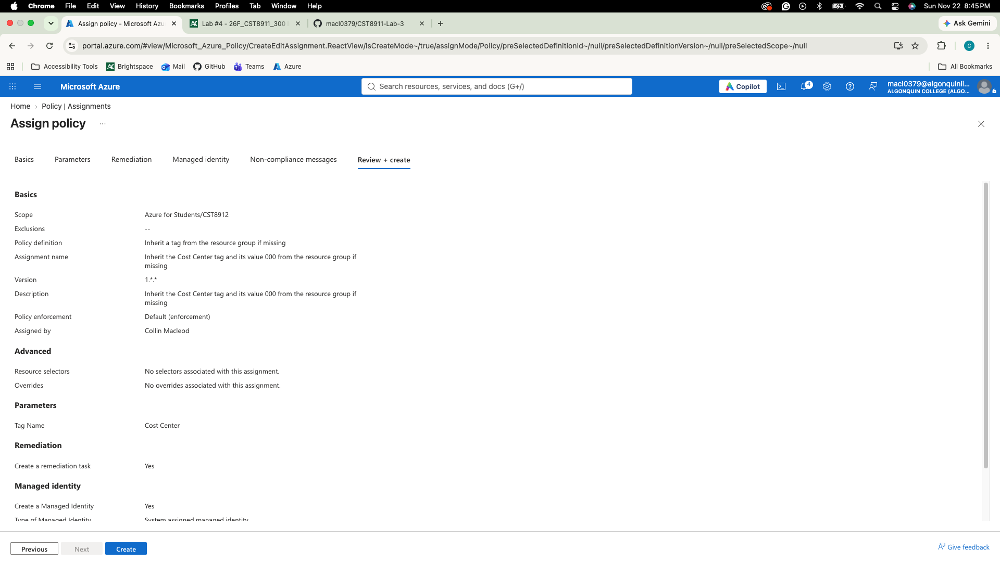
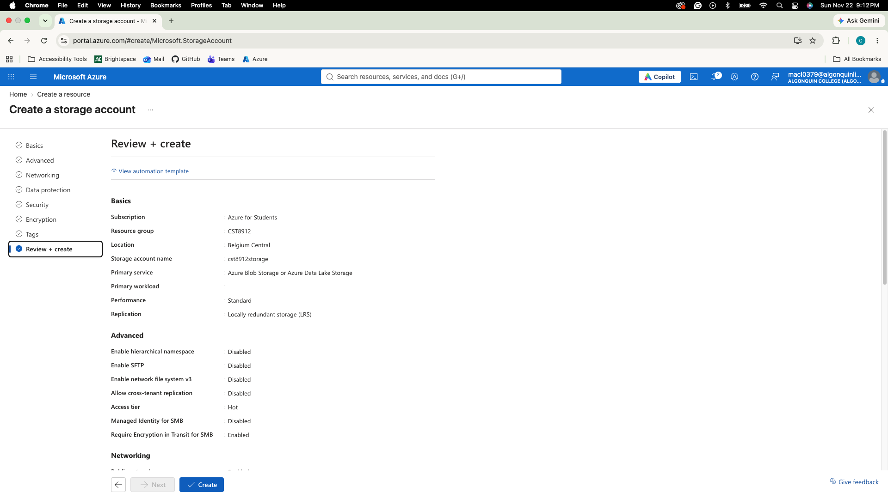
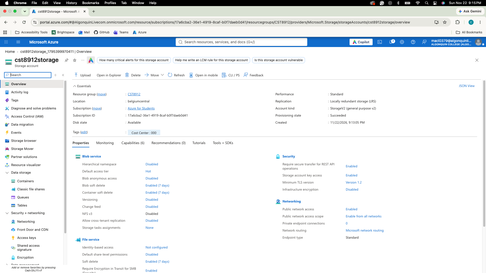
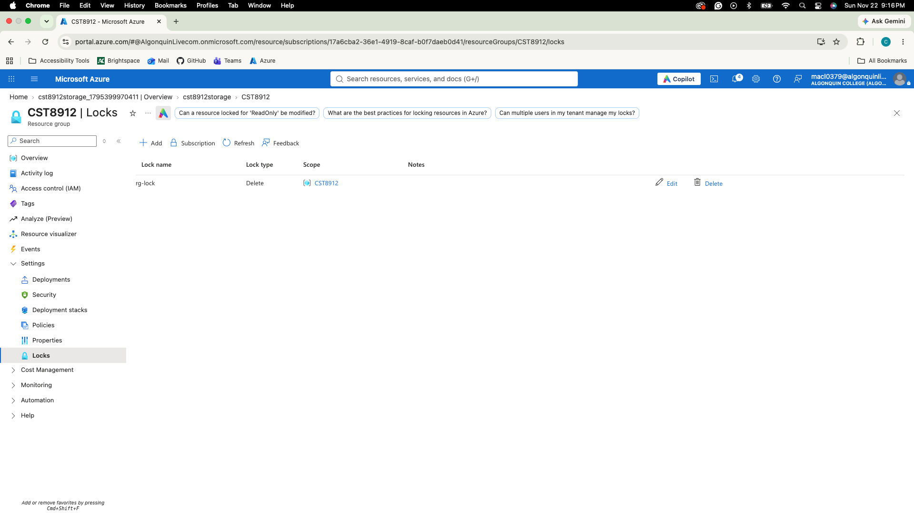
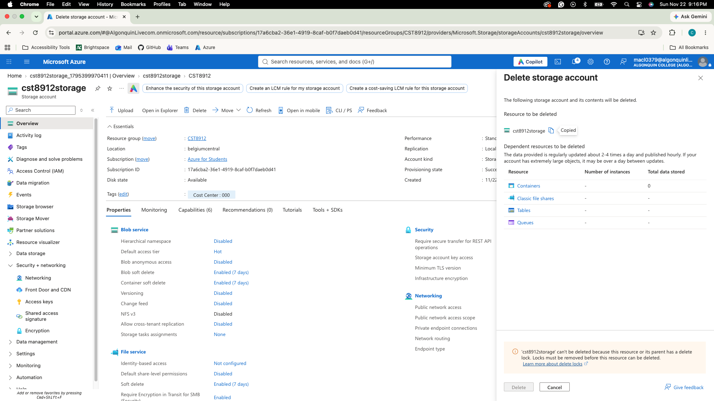
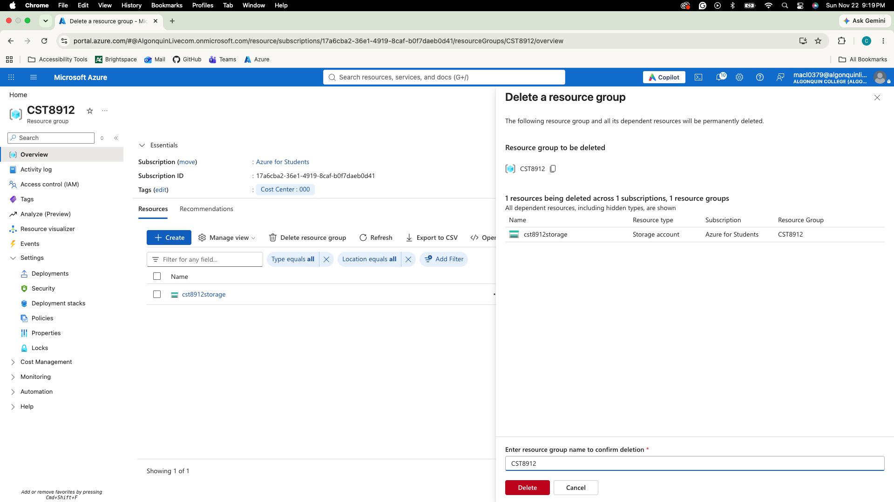

# CST8912 Lab 8

**Student Name**: Collin MacLeod
**Student ID**: macl0379
**Course**: CST8912 Cloud Solutions Architecture
**Semester**: Fall 2026

---

## Introduction

Tagging your resources for a cloud environment is a crucial task for IT, especially when managing and deploying for multiple departments and projects. Tags are one of the elementary tasks included in the Cloud Adoption Framework that lets you take the benefit of the cloud resources to their fullest and ensure that you are taking the maximum advantage of the money spent in the cloud.

Tagging is considered one of the fundamental pillars of Cloud Governance to ensure the workloads deployed in the cloud are organized and stay that way for the entire lifecycle of the resources. Tagging the cloud resources opens up the world of possibility for you to leverage other services such as Cloud Policy and Cloud Runbooks to automate various tasks for specific resources and ensure their compliance in an automated fashion.

In this hands-on lab, you will discover what tags are and how you can implement them in your cloud environment to manage and create the identity for your cloud resources and how to assign azure policy.

## Screenshots

*Figure 1: Policy definition for requiring tags on resources*

*Figure 1: Policy application for requiring Cost Center = 000 tag*

*Figure 1: Storage account creation failure due to tag policy*

*Figure 1: Inherit tags from resource group remediation tab*

*Figure 1: Inherit tags from resource group validation tab*

*Figure 1: Storage account creation with no tags assigned*

*Figure 1: Storage account with tags inherited from resource group*

*Figure 1: Resource lock overview*

*Figure 1: Resource lock halting deletion of resources*

*Figure 1: Cleanup*
